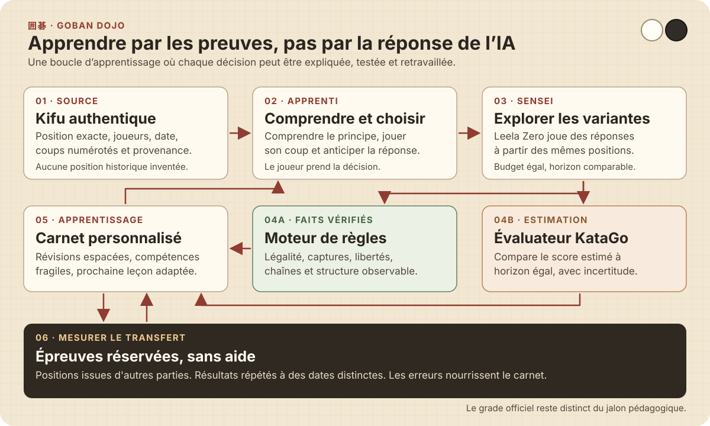

# Goban Dojo

Apprenez le go en rejouant une partie sur un goban en 3D. Importez vos kifu au format SGF ou ceux de votre mentor. À la position qui vous intéresse, choisissez « Explorer » pour jouer votre coup et affronter Leela Zero. Le bilan de KataGo estime le gain ou la perte en points en tenant compte du komi du kifu.

Leela Zero est une reproduction ouverte de la méthode d’AlphaGo Zero. Le réseau embarqué a été entraîné par le projet Leela Zero avec ses propres parties d’autojeu. [Origine et vérification des poids](docs/LEELA-ZERO.md)

L’accueil ouvre le Carnet : leçon, entraînement assisté et révisions sont accessibles directement.
Le mode « Récit » reste disponible dans le menu autour d’Hon’inbō Shūsaku (1829–1862) et ses **469 parties**, de celle du 14 décembre 1839, à l’âge de dix ans, à sa dernière partie, inachevée, du 19 juin 1862. Après un import, ce mode permet aussi de choisir un joueur des SGF pour retrouver ses parties dans l’ordre des dates. Vous pouvez y rechercher sa biographie sur Wikipédia en français ou en anglais, puis choisir l’article à conserver. Seul le nom saisi est transmis à Wikipédia quand vous lancez la recherche. Les SGF importés restent en mémoire en mode visiteur ; ils sont associés au compte Supabase connecté sinon.

[Ouvrir Goban Dojo](https://cdeust.github.io/goban-dojo/)

## Le dojo : une boucle d’apprentissage vérifiée

Goban Dojo applique l’ingénierie de la preuve à un jeu de stratégie. Le Sensei (Leela Zero et KataGo) ne remplace pas la décision du joueur : il génère des alternatives, dont les coups sont vérifiés par le moteur de règles, puis en compare les conséquences. Les faits de plateau sont distincts des estimations probabilistes. Les erreurs déterminent les révisions et le prochain exercice du carnet ; des épreuves sur des parties réservées mesurent le transfert sans indice et sans correction intermédiaire.



- **916 exercices et études**, 39 chapitres sur 9 niveaux, issus de 172 parties historiques. 96 exercices de formation des yeux, dont 37 à deux décisions face à une défense. 40 tsumego de lecture longue ajoutent des captures forcées en 11 à 25 demi-coups, jouées jusqu’au bout. Les modules d’ouverture construisent progressivement les coins, approches, bases, formes et sorties vers le milieu de partie. [Cursus et preuves](docs/ECOLE.md) · [Approche pédagogique](docs/PEDAGOGIE-DOJO.md).
- **128 positions d’évaluation réservées**, réparties en 16 épreuves sans aide. Les objectifs kyū/dan sont des jalons pédagogiques, pas des grades officiels. [Protocole d’évaluation](docs/EVALUATION-KYU-DAN.md) · [Sources et méthode d’étalonnage](docs/ETALONNAGE.md).
- **Sensei d’ouverture** : deux suites de cinq demi-coups, vérifiées légalement, avec réponses réelles de Leela Zero à budget identique et mesures de structure, puis une estimation indépendante de KataGo. [Vérifications et benchmark](docs/BENCHMARK-SENSEI.md).
- **Progression individuelle** : carnet et école synchronisés par compte Supabase ; mode visiteur sans conservation après rechargement. Aucune clé API du projet n’est envoyé au navigateur. [Architecture des comptes](docs/ACCOUNTS.md).


## Ce que fait l’application

- **Un récit en huit chapitres**, de l’enfant d’Innoshima au « saint du go », chaque chapitre
  renvoyant aux parties de la période.
- **Un goban de sol aux cotes réelles** (42,42 × 45,45 × 15,15 cm, lignes à 22 et 23,7 mm), en
  rendu réaliste : kaya à fil droit sur ses pieds tournés, pierres d’ardoise et de coquillage,
  bols de bois, dans un salon à tatamis éclairé par ses shōji. Le bois du goban, les pierres et le décor sont générés dans le navigateur.
- **Une relecture animée par [Motion](https://motion.dev)** : la pierre sort du bol, vient au-dessus
  de l’intersection, frappe et oscille un instant ; revenir en arrière rejoue le geste à l’envers.
- **Des pierres qui tombent pour de bon** : une pierre capturée vole jusqu’au-dessus du couvercle
  de l’adversaire, y chute, rebondit et s’entasse sur les précédentes ; les bols sont garnis de
  pierres simulées de la même façon (moteur physique [Rapier](https://rapier.rs), obstacles tirés
  des maillages des bols et couvercles). Sauter à n’importe quel coup montre le même couvercle
  qu’y arriver coup par coup.
- **Étudier une position.** Au coup affiché, choisissez « Comparer les suites » pour voir jusqu’à dix premiers coups, dont celui du kifu quand il est disponible. Le classement compare le score estimé pour le joueur au trait après une réponse adverse, avec le komi du kifu. Ouvrez une suite pour la parcourir sur le goban ou y jouer votre propre coup. Les captures, ataris et connexions de la partie figurent sous « Repères tactiques du kifu ».
- **Temps de réflexion** : dans la partie de l’oreille rouge, revenez aux interruptions après
  les coups 89 et 141 ou à la position avant Noir 127. Comparez les coups du kifu avec des
  variantes pédagogiques, à votre rythme. Les temps de réflexion individuels sont inconnus.
- **Simuler avec Leela Zero**, une reproduction publique d’AlphaGo Zero. Avant les coups forts,
  le goban rejoue les suites explorées par le moteur. Depuis « Analyser », ouvrez la lecture
  longue pour choisir une branche et suivre les réponses des deux camps, y compris dans
  votre propre SGF. Avec « Coups forts » activé, la lecture de votre SGF s’arrête aussi avant les bons coups
  que le fichier signale par `TE[1]` ou `TE[2]` sur sa ligne principale. Pendant une estimation, choisissez directement la variante sous le goban ou avancez
  d’un coup pour lire la réponse. Avec les animations réduites, le calcul démarre et vous parcourez la suite à votre rythme. Si le moteur s’interrompt, « Réessayer les simulations » reprend à la même position. Les réglages permettent de chercher d’autres premiers coups et de prolonger la suite. Pour étudier une fin de partie,
  filtrez « Parties terminées par abandon » puis choisissez « Continuer après l’abandon » dans
  la fiche. Depuis le dernier coup enregistré, choisissez « Comparer 10 variantes de 20 coups » pour étudier dix réponses possibles sur le même goban. À chaque coup, l’encart indique l’avance estimée et les points gagnés ou perdus par le joueur. Les variantes sont classées par gain estimé au premier coup. Vous pouvez ainsi comparer le coup du kifu au meilleur départ évalué.
  [Provenance des poids et vérification](docs/LEELA-ZERO.md)
- **Lire les variantes** : depuis une position du kifu, le bouton « Analyser » ouvre jusqu’à
  144 suites de deux coups avec KataGo. Cliquez sur un repère lumineux pour jouer un coup,
  examiner les réponses et comparer l’avance estimée à celle du coup historique.
- **Jouer comme Shūsaku** (mode « Deviner ») : la partie s’arrête à chacun de ses coups et vous
  demande où il joue. Un essai manqué donne la distance et une zone qui se resserre ; 3 points du
  premier coup, 2 après un indice, 1 après deux, puis le coup est montré.
- **Première leçon guidée, « La dernière liberté »** : au coup 84 d’un kifu de 1839, repérez
  la dernière liberté d’une pierre, jouez vous-même et voyez la capture. Comparez ensuite les
  suites avec KataGo ou explorez avec Leela Zero. La règle de capture est certaine ; les
  évaluations de la partie entière sont des estimations, pas des solutions imposées.
- **Carnet du dojo** : les positions rencontrées dans « Deviner » reviennent à intervalles
  espacés. Un rappel exact allonge l’intervalle (1, 3, 7, 14 puis 30 jours), un indice ou une
  réponse révélée le ramène à un jour. Proposez un coup sur le goban ou au clavier (coordonnée
  comme D4). Le carnet suit les jours d’entraînement et les paliers
  d’XP sans récompenser la répétition immédiate d’un même coup. Ces paliers ne sont pas des grades
  de go. Le réglage des numéros reste dans ce navigateur ; le carnet est synchronisé avec le compte authentifié (ou reste en mémoire pendant une session visiteur).
- **Explorer une autre suite** (mode « Explorer ») : à partir de n’importe quelle position, posez
  vos propres coups, captures et ko compris, puis revenez à la partie. Sur demande, un réseau de
  neurones de KataGo, exécuté dans le navigateur, juge chaque coup — bon, discutable ou erreur
  probable — et le compare au coup réellement joué. Voir [docs/MOTEUR.md](docs/MOTEUR.md) pour ce
  que vaut ce jugement.
- **L’ouverture de Shūsaku, repérée dans les kifus** : les 68 parties où elle est jouée sont
  signalées, avec une légende aux coups 5 et du kosumi ; le récit en donne le bilan chiffré.
- **Des halos tactiques** : une lumière colorée et sa légende indiquent l’atari, la capture,
  la connexion, le shicho ou un coup remarquable, sans traits de force ni mouvement continu.
  Le bouton « Halos » les désactive.
- **Le son d’une pierre sur du bois massif**, par synthèse modale (choc bref, résonances fixes du
  plateau, acoustique d’une pièce calme) : aucun fichier audio. Les réglages sont une seule table,
  dans `src/replay/sound.ts`.
- **Trois points de vue** (joueur, trois-quarts, dessus) et l’orbite libre, les numéros de coups
  façon kifu, la lecture continue d’une partie à la suivante, une recherche par adversaire, année
  ou lieu (les lieux sont donnés en français).
- **Accessible** : tout se pilote au clavier, chaque coup est annoncé en toutes lettres aux
  lecteurs d’écran, la préférence système « réduire les animations » est respectée.

## Lancer

Node 26 et pnpm 10.

```bash
pnpm install --frozen-lockfile
pnpm dev          # http://127.0.0.1:5173
```

Tout vérifier d’une seule commande (données, types, lint, format, tests, audit, build, e2e) :

```bash
pnpm exec playwright install chromium   # une fois
pnpm check
```

| Commande          | Rôle                                                                      |
| ----------------- | ------------------------------------------------------------------------- |
| `pnpm data:fetch` | re-télécharge les SGF au commit épinglé et vérifie chaque empreinte       |
| `pnpm data:build` | reconstruit `public/data/games.json` et `data/report.json` (déterministe) |
| `pnpm test`       | règles, analyseur SGF, corpus rejoué, ouverture, lieux, physique, moteur  |
| `pnpm arch`       | frontières entre couches et absence de cycles d’imports                   |
| `pnpm e2e`        | parcours complets et contrôles de sécurité sur la version construite      |
| `pnpm sbom`       | inventaire CycloneDX des dépendances de production                        |
| `pnpm build`      | données + site statique dans `dist/`                                      |

## Les données

Le corpus vient de la collection « Games by Shusaku » d’A. E. Brouwer (CWI) : 470 fichiers SGF
dérivés du recueil 本因坊秀策全集, avec pour chaque partie la date japonaise et sa conversion
grégorienne. Le _Professional Go Dataset_ complète le lieu et les circonstances de 188 parties ;
les lieux, donnés en anglais par les sources, sont traduits en français.
Les deux sources sont épinglées et vérifiées par empreinte. Le détail du traitement, les
contrôles et les réserves sont dans [docs/DONNEES.md](docs/DONNEES.md). En bref :

- **469 parties, 85 577 coups**, chacune rejouée par le moteur de règles : **zéro coup illégal** ;
- le corpus recoupe l’histoire : **19 parties du château, 19 victoires** ; **23 parties** du
  sanjūbango contre Ōta Yūzō, la dernière nulle ; l’oreille rouge en 325 coups, coup 127 en K11 ;
- aucun kifu antérieur à décembre 1839 n’a été trouvé : les parties de l’enfance à Innoshima ne
  sont connues que par le récit ;
- 51 parties sont inachevées, une partie de 1842 n’a laissé que ses métadonnées ;
- l’ouverture de Shūsaku est jouée dans **68 parties**, dont 52 de sa main (42 victoires).

Le récit s’appuie d’abord sur l’Institut japonais de go (日本棋院), qui confirme l’entrée chez
Jōwa, le titre d’héritier, les dix-neuf victoires au château, le coup 127 et la mort du choléra.
Le reste (naissance, grades, match contre Ōta Yūzō) vient encore de deux révisions datées de
Wikipédia (fr, en) et **attend une confirmation** par une source de référence. Une divergence est
signalée dans le récit : l’oreille rouge est gagnée de deux points selon le kifu, de trois selon
l’Institut. Toutes les sources sont citées dans l’application et dans
[`src/story/chapters.ts`](src/story/chapters.ts).

## Architecture

```
data/cwi + data/pgd ──► scripts/build-data.ts ──► public/data/games.json
                        │ (src/domain : SGF, règles, vie de chaque pierre, ouverture)
                        ▼
src/state/store.ts ──► src/replay (horloge, son) ──► src/scene (three.js + Motion)
        │                                              Goban · Stones · Bowls · Room · CameraRig
        │                                              physics (Rapier) : chute et repos des pierres
        └────────────► src/ui (récit, parties, commandes) ◄── src/story (chapitres, sources)
```

`src/domain` ne dépend de rien et sert à la fois au pipeline de données, à l’application et aux
tests ; `src/engine` (encodage des positions, jugement des coups) ne dépend que du domaine. Ces
frontières sont vérifiées par `pnpm arch`, qui échoue sur tout import interdit ou cyclique ; le
moteur physique n’est importé que par `src/scene/physics.ts`. Dans la scène, chaque pierre physique est une instance dont l’état cible (dans le bol, sur
le goban, prisonnière) se déduit du numéro de coup ; Motion anime le passage d’un état à l’autre.

## Qualité et sécurité

- [docs/MENACES.md](docs/MENACES.md) — modèle de menaces STRIDE et mesures en place.
- [docs/JOURNAL.md](docs/JOURNAL.md) — journal des expériences, échecs compris.
- Dépendances en versions exactes, lockfile figé, actions GitHub épinglées par empreinte,
  SBOM CycloneDX, `pnpm audit`, ESLint avec règles de sécurité et CodeQL (SAST), tests Playwright
  sur la version construite pour vérifier la CSP et les requêtes réseau (DAST).

## Licences

Le code est sous licence MIT. Les textes biographiques sont rédigés à partir du site de
l’Institut japonais de go et de Wikipédia (CC BY-SA 4.0), cités. Les kifus sont des parties du XIXᵉ siècle ; les fichiers SGF proviennent
de deux collections : CWI présente les parties comme relevant du domaine public ; les droits PGD restent distincts et à vérifier — voir [docs/DONNEES.md](docs/DONNEES.md).
La police Shippori Mincho est sous SIL OFL 1.1. Le moteur physique Rapier est sous Apache-2.0. Le réseau de neurones et le code porté de KataGo
sont décrits dans [public/engine/LICENCE.txt](public/engine/LICENCE.txt).

## Comptes et sauvegarde

Voir [Comptes Supabase](docs/ACCOUNTS.md) pour la session visiteur, la migration des anciennes sauvegardes, les paramètres de configuration et les tests locaux.
