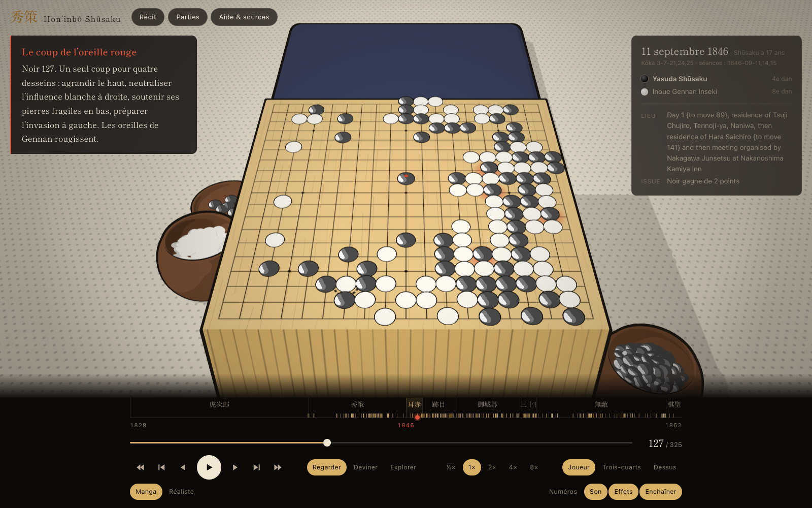

# 秀策 — Hon’inbō Shūsaku, 1829-1862

Un goban en 3D pour revoir, coup après coup, **469 parties** de Hon’inbō Shūsaku : de la plus
ancienne qui nous soit parvenue (14 décembre 1839, il a dix ans) à la dernière, inachevée, du
19 juin 1862, dix semaines avant sa mort.



## Ce que fait l’application

- **Un récit en huit chapitres**, de l’enfant d’Innoshima au « saint du go », chaque chapitre
  renvoyant aux parties de la période.
- **Un goban de sol aux cotes réelles** (42,42 × 45,45 × 15,15 cm, lignes à 22 et 23,7 mm) :
  kaya à fil droit, pierres d’ardoise et de coquillage, bols, couvercles où s’accumulent les
  prisonniers, tatamis. Tout est procédural : aucune image, aucun modèle, aucun son n’est téléchargé.
- **Une relecture animée par [Motion](https://motion.dev)** : la pierre sort du bol, vient au-dessus
  de l’intersection, frappe et oscille un instant ; les pierres capturées s’envolent vers le
  couvercle de l’adversaire ; revenir en arrière rejoue le geste à l’envers.
- **Jouer comme Shūsaku** (mode « Deviner ») : la partie s’arrête à chacun de ses coups et vous
  demande où il joue. Un essai manqué donne la distance et une zone qui se resserre ; 3 points du
  premier coup, 2 après un indice, 1 après deux, puis le coup est montré.
- **Explorer une autre suite** (mode « Explorer ») : à partir de n’importe quelle position, posez
  vos propres coups, captures et ko compris, puis revenez à la partie. Sur demande, un réseau de
  neurones de KataGo, exécuté dans le navigateur, juge chaque coup — bon, discutable ou erreur
  probable — et le compare au coup réellement joué. Voir [docs/MOTEUR.md](docs/MOTEUR.md) pour ce
  que vaut ce jugement.
- **Un rendu manga**, par défaut : aplats, contours à l’encre, trames et hachures, pierres noires
  au reflet net. Le rendu réaliste (kaya, ardoise, coquillage, tatamis) reste disponible d’un
  bouton ; les deux styles partagent géométrie, animations et effets, et ne diffèrent que par
  `src/scene/look.ts` et les matériaux qu’il fournit.
- **Des marques qui disent ce que fait un coup** : halo rouge sous les pierres en atari
  (attaque), cage tournante autour des pierres prises dans un shicho qui fonctionne (piège), halo
  bleu sous le coup qui relie deux groupes (connexion). Le coup lui-même frappe avec un éclat et
  des lignes de force ; au coup 127 de la partie de l’oreille rouge, la scène s’assombrit autour
  de la pierre. Tout se coupe d’un bouton.
- **Le son d’une pierre sur du bois massif**, par synthèse modale (choc bref, résonances fixes du
  plateau, acoustique d’une pièce calme) : aucun fichier audio. Les réglages sont une seule table,
  dans `src/replay/sound.ts`.
- **Trois points de vue** (joueur, trois-quarts, dessus) et l’orbite libre, les numéros de coups
  façon kifu, la lecture continue d’une partie à la suivante, une recherche par adversaire, année
  ou lieu.
- **Accessible** : tout se pilote au clavier, chaque coup est annoncé en toutes lettres aux
  lecteurs d’écran, la préférence système « réduire les animations » est respectée.

## Lancer

Node 26 et pnpm 10.

```bash
pnpm install --frozen-lockfile
pnpm dev          # http://127.0.0.1:5173
```

Tout vérifier d’une seule commande (données, types, lint, format, tests, audit, build, e2e) :

```bash
pnpm exec playwright install chromium   # une fois
pnpm check
```

| Commande          | Rôle                                                                      |
| ----------------- | ------------------------------------------------------------------------- |
| `pnpm data:fetch` | re-télécharge les SGF au commit épinglé et vérifie chaque empreinte       |
| `pnpm data:build` | reconstruit `public/data/games.json` et `data/report.json` (déterministe) |
| `pnpm test`       | moteur de règles, analyseur SGF, corpus rejoué coup par coup              |
| `pnpm e2e`        | parcours complets et contrôles de sécurité sur la version construite      |
| `pnpm sbom`       | inventaire CycloneDX des dépendances de production                        |
| `pnpm build`      | données + site statique dans `dist/`                                      |

## Les données

Le corpus vient de la collection « Games by Shusaku » d’A. E. Brouwer (CWI) : 470 fichiers SGF
dérivés du recueil 本因坊秀策全集, avec pour chaque partie la date japonaise et sa conversion
grégorienne. Le _Professional Go Dataset_ complète le lieu et les circonstances de 195 parties.
Les deux sources sont épinglées et vérifiées par empreinte. Le détail du traitement, les
contrôles et les réserves sont dans [docs/DONNEES.md](docs/DONNEES.md). En bref :

- **469 parties, 85 577 coups**, chacune rejouée par le moteur de règles : **zéro coup illégal** ;
- le corpus recoupe l’histoire : **19 parties du château, 19 victoires** ; **23 parties** du
  sanjūbango contre Ōta Yūzō, la dernière nulle ; l’oreille rouge en 325 coups, coup 127 en K11 ;
- aucun kifu antérieur à décembre 1839 n’a été trouvé : les parties de l’enfance à Innoshima ne
  sont connues que par le récit ;
- 51 parties sont inachevées, une partie de 1842 n’a laissé que ses métadonnées.

Le récit s’appuie sur deux révisions datées de Wikipédia (fr, en) et sur la page de la
collection, citées dans l’application et dans [`src/story/chapters.ts`](src/story/chapters.ts).

## Architecture

```
data/cwi + data/pgd ──► scripts/build-data.ts ──► public/data/games.json
                        │ (src/domain : SGF, règles, vie de chaque pierre)
                        ▼
src/state/store.ts ──► src/replay (horloge, son) ──► src/scene (three.js + Motion)
        │                                              Goban · Stones · Bowls · Room · CameraRig
        └────────────► src/ui (récit, parties, commandes) ◄── src/story (chapitres, sources)
```

`src/domain` ne dépend de rien et sert à la fois au pipeline de données, à l’application et aux
tests ; `src/engine` (encodage des positions, jugement des coups) ne dépend que du domaine. Ces
frontières sont vérifiées par `pnpm arch`, qui échoue sur tout import interdit ou cyclique. Dans la scène, chaque pierre physique est une instance dont l’état cible (dans le bol, sur
le goban, prisonnière) se déduit du numéro de coup ; Motion anime le passage d’un état à l’autre.

## Qualité et sécurité

- [docs/MENACES.md](docs/MENACES.md) — modèle de menaces STRIDE et mesures en place.
- [docs/JOURNAL.md](docs/JOURNAL.md) — journal des expériences, échecs compris.
- Dépendances en versions exactes, lockfile figé, actions GitHub épinglées par empreinte,
  SBOM CycloneDX, `pnpm audit`, ESLint avec règles de sécurité et CodeQL (SAST), tests Playwright
  contre la version construite avec vérification de la CSP et de l’absence de toute requête
  sortante (DAST).

## Licences

Le code est sous licence MIT. Les textes biographiques sont rédigés à partir de Wikipédia
(CC BY-SA 4.0), cité. Les kifus sont des parties du XIXᵉ siècle ; les fichiers SGF proviennent
de deux collections qui ne déclarent pas de licence — voir [docs/DONNEES.md](docs/DONNEES.md).
La police Shippori Mincho est sous SIL OFL 1.1. Le réseau de neurones et le code porté de KataGo
sont décrits dans [public/engine/LICENCE.txt](public/engine/LICENCE.txt).
